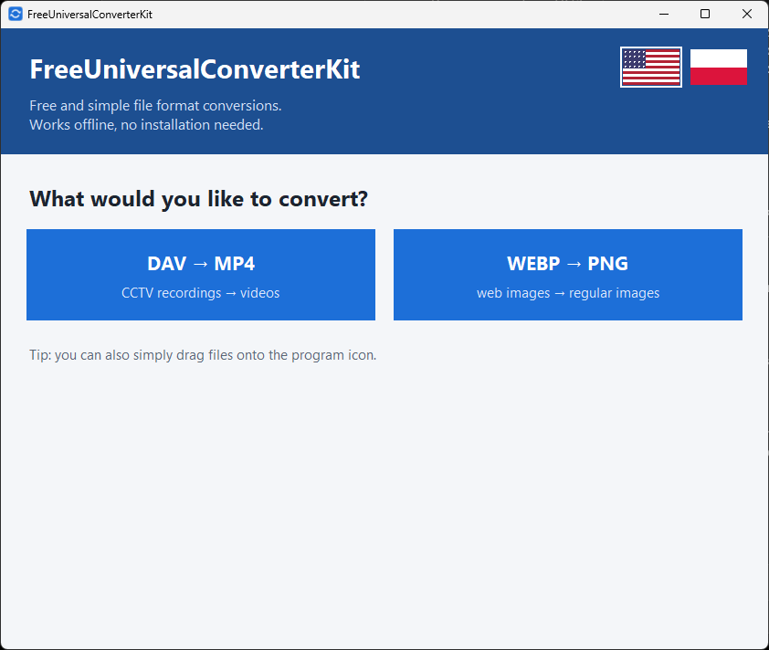
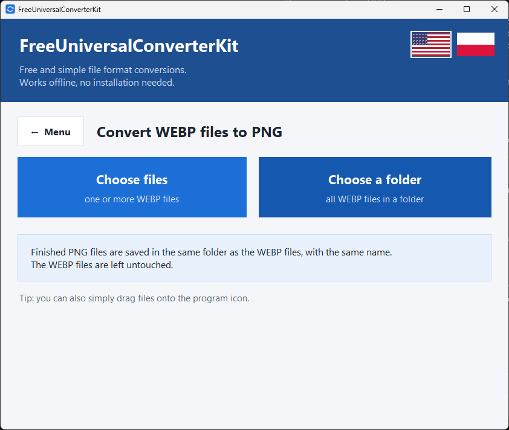
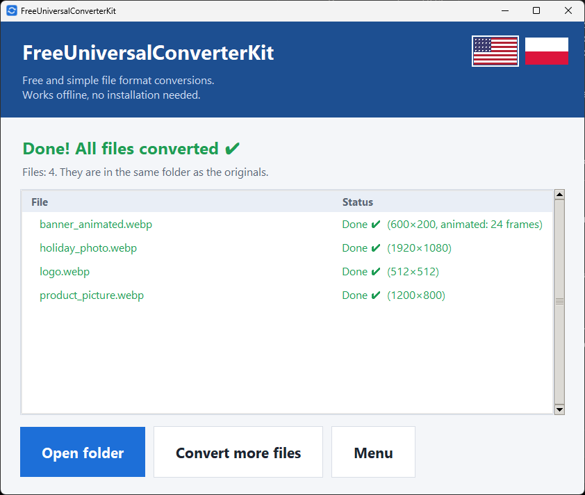

# FreeUniversalConverterKit

**FreeUniversalConverterKit** (FUCK for short) is a free, portable Windows program for simple file format
conversions – one window, big buttons, clear progress, no settings to get wrong. Made to be easy for everyone,
including people who don't use computers much. More conversions will be added over time.

### ⬇️ [Download FreeUniversalConverterKit.exe](https://github.com/Oui42/FreeUniversalConverterKit/releases/latest/download/FreeUniversalConverterKit.exe)

One file, no installation, works offline. Windows 10/11 (64-bit).



## Conversions

| Conversion | What it does |
|---|---|
| **DAV → MP4** | CCTV recordings from video recorders (DVR/NVR) to regular videos. The video is repackaged, not re-encoded – no quality loss and very fast (a 1-hour recording takes a few seconds). |
| **WEBP → PNG** | Web images to regular PNG images. Transparency, colour profile and EXIF are kept. Animated WEBP becomes an animated PNG (APNG) with the same frame timing. |

### DAV → MP4 details

"DAV" is not a single format – different recorder brands write different files with the same extension.

| Recorder / file | How it is converted | Status |
|---|---|---|
| **JUAN / JuFeng** recorders (file starts with the `JUFEN` header), H.264 and H.265 video | built-in reader, repackaged to MP4 without re-encoding, real frame timestamps kept and known recorder timestamp glitches repaired | tested with real recordings |
| **Dahua** and other .dav files that FFmpeg can read | repackaged with FFmpeg (audio converted to AAC); if that fails, re-encoded to H.264 | should work – not yet tested with real Dahua recordings |

H.265 videos play in VLC and most modern players. The built-in Windows "Media Player" / "Films & TV" app needs
the free *HEVC Video Extensions* from the Microsoft Store to play H.265.

## Features

- **One portable .exe** – nothing to install, nothing is written next to the program.
- **Whole folders at once** – subfolders included; each result is saved next to its original with the same name.
- **Clear progress** – progress bar for the current file and for all of them, time left, status of each file.
- **Safe** – the original files are never changed; files that were already converted are skipped;
  stopping or closing never leaves a broken, half-written file; the result gets the date of the original.
- **Drag and drop** – drop files or a folder onto the program icon and the right conversion starts by itself.
- **English and Polish** – starts in Polish on a Polish Windows, in English otherwise; switch any time with
  the flag buttons in the top-right corner (the choice is remembered).

| Choosing files | Done |
|---|---|
|  |  |

## How to use

1. Download [FreeUniversalConverterKit.exe](https://github.com/Oui42/FreeUniversalConverterKit/releases/latest/download/FreeUniversalConverterKit.exe)
   and double-click it.
2. Choose what to convert in the menu, e.g. **WEBP → PNG**.
3. Click **Choose files** or **Choose a folder**.
4. Wait until you see **Done!** and click **Open folder**.

> **"Windows protected your PC"?** The program is not digitally signed (a code-signing certificate is paid),
> so Windows SmartScreen or an antivirus may warn about it the first time. Click **More info → Run anyway**.
> You can check the source code in this repository and build the program yourself (see below).

If a file cannot be converted, the program marks it in red and explains why. Please
[open an issue](https://github.com/Oui42/FreeUniversalConverterKit/issues) if something doesn't work or if you
would like another conversion to be added.

## Command line

```
python cli.py "D:\Recordings" picture.webp
```

Each file is converted by the conversion that matches its extension.

## Building from source

Requirements: Windows, [Python 3.10+](https://www.python.org/downloads/).

```
build.bat
```

The script creates a virtual environment, installs the requirements
([Pillow](https://python-pillow.org), [imageio-ffmpeg](https://github.com/imageio/imageio-ffmpeg) for `ffmpeg.exe`)
and [PyInstaller](https://pyinstaller.org), and builds `dist\FreeUniversalConverterKit.exe`.
To run the program without building: `pip install -r requirements.txt` and `python app.py`.

| File | Purpose |
|---|---|
| `app.py` | the window (Tkinter): menu, file choice, progress; texts in English and Polish |
| `converters/` | one module per conversion + shared base (`base.py`) |
| `cli.py` | command-line use |
| `build.bat` | builds the portable .exe |
| `app.ico`, `splash.png` | icon and start-up screen |

Settings (only the chosen language) are stored in `%APPDATA%\FreeUniversalConverterKit\settings.json`.

### Adding a conversion

1. Create `converters/<name>.py` with a class based on `Converter` (see `converters/webp_png.py` –
   about 60 lines): set `src_ext`, `dst_ext`, the menu texts (`names`) and the file type label (`file_type`)
   in English and Polish, and implement `_convert(src, tmp, progress, cancel)`, which writes the result to `tmp`.
   Saving, skipping finished files, cancelling and error messages are handled by the base class.
2. Add an instance to `CONVERTERS` in `converters/__init__.py` – it appears in the menu automatically.

## License

The source code is released under the [MIT License](LICENSE).
The portable .exe contains FFmpeg (GNU GPL version 3) and Pillow – see [THIRD-PARTY-NOTICES.md](THIRD-PARTY-NOTICES.md).

## Support

FreeUniversalConverterKit is free and made in spare time. If it saves you work, you can buy me a coffee: https://buymeacoffee.com/oui42
